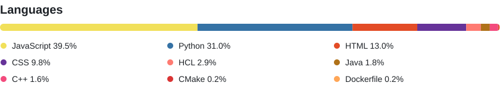

<picture>
  <source media="(prefers-reduced-motion: reduce)" srcset="assets/digital-rain-static.svg">
  
</picture>

# Kenyon Melton

I’m Kenyon Melton, a developer and cybersecurity student at Franklin University. Explore my software projects, client work, hardware builds, and home lab. I have pinned current projects, please leave a star if you like them. Thanks!

## Project languages

Based on code bytes reported by GitHub across my public original repositories. Excludes forks and this profile repository. Updated every 12 hours. Percentages describe project composition, not proficiency.

## Tech stack

**Frameworks & libraries**

    

**Database**

**Build & infrastructure**

   

**Testing & automation**

  

Click a badge to explore a project that uses it.

## Contribution arcade

<picture>
  <source media="(prefers-reduced-motion: reduce)" srcset="assets/contribution-arcade-static.svg">
  
</picture>

A separate animation of my GitHub contribution data, refreshed every 12 hours. It does not modify GitHub’s native contribution grid. [Static view](assets/contribution-arcade-static.svg) · [Static header](assets/digital-rain-static.svg)
